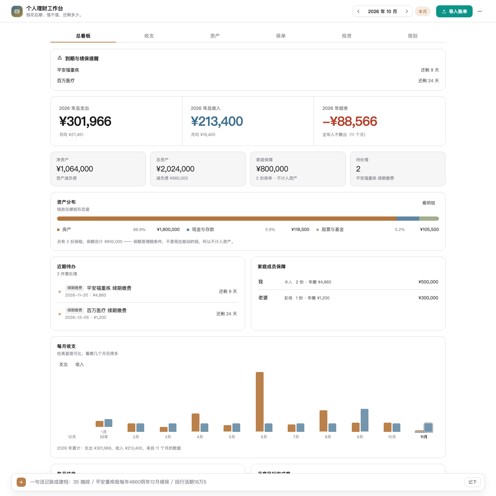
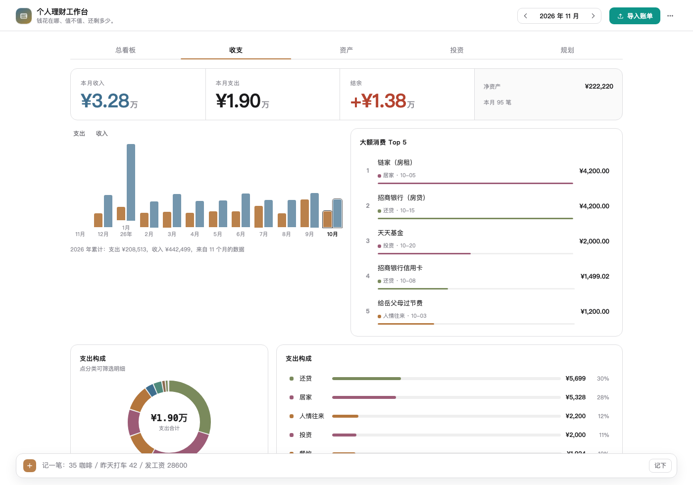

# 个人理财工作台 · @wayne/dsh-finance

> **把散在支付宝、微信、银行卡里的钱，合成一张能看懂的图。**
> 导入账单 → 自动分类 → 自动合并重复 → 自动出图。一个 [DeepSeek Harness](https://github.com/deepseek-ai) 插件，数据只存你自己的电脑。

<p align="center">
  
</p>

---

## 为什么不直接用现成的记账 App

因为**记账总会断在第三天**。不是因为懒，是因为记账这件事的苦活全压在用户身上：钱散在五六个 App 里，每笔都要手敲，分类要想，月底还要自己汇总。

真正该由机器做的三件事是：**把账单读进来、把重复的去掉、把数字算成图**。这个工作台只做这三件，其余才交给你判断。

---

## 三个别人不做、但错了最要命的地方

记账工具真正的差异不在图表好不好看，而在**算得对不对**。这三处特别容易错，而且错了很难发现：

### 一、同一杯咖啡，被记成了三笔

你在星巴克刷卡 ¥35，这笔钱会同时出现在：

```
星巴克 ¥35（2026-11-05 08:12:33）
  ├─ 支付宝账单     「星巴克(南京西路)」付款方式：招商银行信用卡(5678)
  ├─ 招行信用卡账单 「星巴克 -35.00」
  └─ 招行储蓄卡账单 「信用卡还款 -246.00」（这个月还的是上个月）
```

三份一起导入，一杯咖啡变成 ¥70 支出，还款还被当成了另一笔消费。

**这个插件会**：从账单的「收/付款方式」列识别每笔钱走的渠道（支付宝/微信/花呗/白条/美团月付/具体某张卡），按**渠道优先级**只保留最源头的那条（先买后付 > 信用卡 > 银行卡 > 支付宝/微信），并把信用卡消费与它的还款合并成一笔。

实测三份账单共 7 条记录，最终支出 **¥279**，正好等于真实消费 35 + 199 + 45。

> 判定是**保守**的：日期、金额、方向必须严格一致，带时间戳的要求相差不超过 3 分钟。宁可有重复没合并，也不把两笔真实消费错并成一笔——后者会让你以为这个月少花了钱，更难发现。

### 二、转账到底算不算花了

同一笔「钱动了」，含义可能完全不同：

| 场景 | 怎么记 | 为什么 |
|---|---|---|
| 工资到账 | **计入收入** | 真赚了。银行把它记成「转账 某某公司」也照算 |
| 转 2 万到余额宝 | **不计收支** | 钱还在你名下，只是换了个账户 |
| 还房贷 ¥7,800 | **计入支出** | 钱确实花掉了，变成了房子 |
| 信用卡还款 | **不计收支** | 刷卡时已记过支出，还款只是清偿 |
| 借给朋友 | **不计收支** | 是债权，不是消费也不是收入 |
| 淘宝退款 | **不计收支** | 冲抵原支出，不是新收入 |
| 换电脑 ¥9,899 | **计入支出，标「待确认」** | 大额消费是真实支出，不因金额大就排除 |

把转账 2 万当支出，会**同时虚增当月「收入 2 万」和「支出 2 万」**——结余看着没变，但两个大数全错、饼图被「其他」撑满、预算判断失真。

判定策略是**先证据、后金额**：只看金额大小是很糟的规则（还房贷金额很大，但确实是支出）。

被排除的行**不会从账本里消失**，它们留在流水里可查，面板会明说「另有 N 笔转账/还款 ¥X 未计入收支」。

### 三、金额从来不用浮点数

全程用「分」的整数（`1234` = ¥12.34），只在最后展示时除以 100。分类占比、预算对比、盈亏计算因此永远能对得上——「三个大数与明细加总一致」是测试里逐条断言的事。

---

## 五个页面

| 页面 | 回答什么问题 | 截图 |
|---|---|---|
| **总看板** | 今年一共花了多少？哪几个月花得多？ | [见上](#) |
| **收支** | 这个月钱花哪了、花得值不值 | ↓ |
| **资产** | 我现在净资产多少 | |
| **投资** | 投出去的钱赚没赚 | |
| **规划** | 离目标还有多远 | |

<p align="center">
  
</p>

**总看板**：年度支出/收入/结余三个大数（带月均），12 个月收支双柱（柱高直接可比），每月结余（负值朝下，一眼看出哪几个月入不敷出），月度目标完成度（超支时进度条变成斜纹红），年度支出构成环形图。

**收支**：本月三数大卡、分类环形图（点图例或扇形直接筛选流水）、近 12 月趋势、大额消费 Top5、可搜索/编辑/删除的流水表。

**资产**：净资产居中，资产构成环、净资产走势，负债列表含还款日与临近高亮。

**投资**：总盈亏与收益率、股债现金配置、逐笔持仓盈亏（**红涨绿跌 + ↑↓ 符号**，不依赖颜色辨识）。

**规划**：分类预算 vs 实际（双色条 + 45° 斜纹溢出段）、存钱目标进度、通用提示。

---

## 随手记一笔

记账最大的敌人不是不会算，是**懒得录**。所以面板底部常驻一条输入框，一句话就能记账：

```
35 咖啡              → ¥35.00 餐饮   今天
昨天打车 42           → ¥42.00 交通   昨天
发工资 28600          → ¥28,600 收入  今天
11-05 超市 128.5      → ¥128.50 居家  11 月 5 日
```

输入时实时显示解析出的**金额 · 商户 · 日期**，认不出金额就在原地提示，**绝不会记错一笔**。按回车即入账，分类交给规则引擎。

也可以直接跟 AI 说话——插件提供了 8 个工具：

> 「记一笔 35 块的咖啡」「我上个月餐饮花了多少」「把这个账单文件导进来」「导出我 10 月的流水」

---

## 安装

需要 DeepSeek Harness（Desktop，或带 Web UI 的 dsh）。**没有原生依赖，不额外装任何包。**

### 从 GitHub 安装（最省事）

在 Harness 的插件管理器里 `install_bundle`，target 填：

```
https://github.com/WayneZhon/dsh-finance/archive/refs/tags/v1.3.0.tar.gz
```

### 从本地目录安装（改代码即时生效）

```bash
git clone https://github.com/WayneZhon/dsh-finance.git
cd dsh-finance
npm run build     # 把 locale 字典编译进 client.js
npm test          # 203 例，全离线，不需要模型也不需要网络
```

然后用 `install_bundle` 指向这个目录的绝对路径。

> `client.js` 是**已构建**的产物并随包发布，所以从 GitHub/npm 装不需要本地再跑构建；只有改 `client.src.js` 才需要 `npm run build`。

### 首次打开

**装完就是一个干净的账本**，没有预填任何数据。两个入口：

- **导入我的账单**：拖入支付宝/微信/银行导出的文件，解析完先给预览，确认后入库
- **先看看示例长什么样**：写入一份 12 个月的演示账本，明确标注「这是演示账本」，随时一键清空

> 理财插件里的数字必须先是用户自己的。想改成装完自动铺演示数据，配置里设 `demo: true`。

---

## 怎么拿到你的账单

| 来源 | 路径 |
|---|---|
| **支付宝** | 我的 → 账单 → 右上角「···」→ 开具交易流水证明 / 账单导出 → 下载 CSV（邮件里是 zip，需解压） |
| **微信支付** | 我 → 服务 → 钱包 → 账单 → 常见问题 → 下载账单 → 用于个人对账 |
| **银行 / 信用卡** | 网银或 App 里导出「交易明细」，选 CSV / Excel |
| **京东白条 / 美团月付** | 各自 App 的账单页导出，或从支付渠道那一侧的自然合并 |

支持的格式：支付宝 CSV（UTF-8 / GBK 自动识别）、微信 CSV、通用银行 CSV / TSV、Excel `.xlsx`、SpreadsheetML `.xml`。表头前的说明文字、`¥` 符号、千分位、引号内逗号都能处理。

**建议顺序**：先导支付宝 + 微信，再导银行卡/信用卡——后导入的会自动和前面合并，你会看到「其中 N 笔是其他账单里已记过的同一笔」。

---

## 数据与隐私

一份 JSON 文件，默认 `~/.dsh/dsh-finance/finance.json`：

- **原子写**：先写临时文件再 rename，进程被杀也不会留下半截 JSON
- **串行队列**：连点两次不会互相覆盖
- **坏文件不丢数据**：读盘失败会把原文件改名成 `.corrupt-<时间戳>` 备份，再从空账本开始并告诉你

**隐私边界：**

- 不联网、不碰银行接口、不下单、不做投顾、无埋点
- 唯一的出网调用是 AI 洞察，走你自己的默认模型，**只发聚合后的数字摘要，不发逐笔商户明细**
- 不用 AI 也完全可用：规则引擎照常出图，界面如实标注来源

想换位置：配置里设 `file`。想备份：面板「更多 → 导出备份」。

---

## 开发

```bash
npm run build           # 重建 client.js
npm run check           # 语法 + 构建产物是否最新
npm test                # 203 例：Host 141 + 集成 21 + 面板 41
npm run pack:check      # 看发布出去的 tarball 里有什么
npm run prepublishOnly  # 发布前门禁（npm publish 会自动跑）
```

改 `client.src.js` / `locale/*.json` 后 `npm run build` + 刷新页面即可；改 `index.js` / `lib/*.js` 需在插件管理器里关掉再打开插件。

### 三条硬约束

1. **金额全程用「分」的整数**，只在展示时除以 100
2. **浏览器半边只能 require `react` 与 `react/jsx-runtime`**，其余用平台无关的 DOM / SVG / `--dsw-*` token
3. **Host 半边不 import 任何 `@deepseek-ai/*`**，只通过 `ctx.*` 服务取能力

`locale/zh.json` 是键集的唯一真源，`locale/en.json` 必须完全一致，否则构建直接失败。详见 [CONTRIBUTING.md](CONTRIBUTING.md)。

### 架构

```
@wayne/dsh-finance/
├── index.js               Host 入口：store / AI 桥 / 8 个工具 / 路由挂载
├── client.src.js          浏览器面板（五个页面 + 导入向导 + 纯 SVG 图表）
├── client.js              构建产物（scripts/build.mjs 生成，勿手改）
├── lib/
│   ├── domain.js          领域常量、金额（分）、日期月份、去重指纹 —— 纯函数
│   ├── store.js           本地 JSON 账本：原子写、串行队列、去重导入
│   ├── importer.js        支付宝 / 微信 / 通用 CSV / 最小 xlsx 解析
│   ├── classify.js        规则分类（商户关键词 + 用户修正记忆）
│   ├── flow.js            收支口径判定（转账/还款/借贷不算收支）
│   ├── channel.js         支付渠道识别 + 跨账单去重
│   ├── analysis.js        看板聚合：年度 / 收支 / 资产 / 投资 / 预算 / 目标
│   ├── routes.js          /dsh-finance/api/* HTTP 接口（带信任栅栏）
│   ├── tools.js           8 个 finance_* agent 工具
│   └── ai.js              AI 桥：分类兜底 + 洞察，失败一律降级
├── locale/{zh,en}.json    双语文案
└── scripts/
    ├── build.mjs          字典注入 + 构建期校验
    ├── test.mjs           面板离线测试（最小 React 替身 + 假 DOM）
    ├── test-integration.mjs  Host 端到端测试
    └── fixtures/          样例账单
```

---

## 不做的事

这个插件**只记录与展示**，不替用户动钱：

- ❌ 不碰银行（不转账、不付款、不开户）
- ❌ 不做投顾（不推荐买哪只股票/基金）
- ❌ 不上传你的账单
- ❌ 不做「授权同步」——微信/支付宝的个人账单没有开放 API（支付账单接口是**商户**维度的），任何声称能自动同步的工具，要么让你手工上传，要么在爬你的账号

---

## 已知限制

- **行情需手动录入现价**（自动拉取需要第三方行情接口）
- **支付宝/微信账单需先解压**（下载的是 zip）
- 跨账单去重是**保守**的：极少数情况下（不同商户名、不同金额）同一笔消费仍会重复，需要手动删

---

## License

MIT — 见 [LICENSE](LICENSE)。